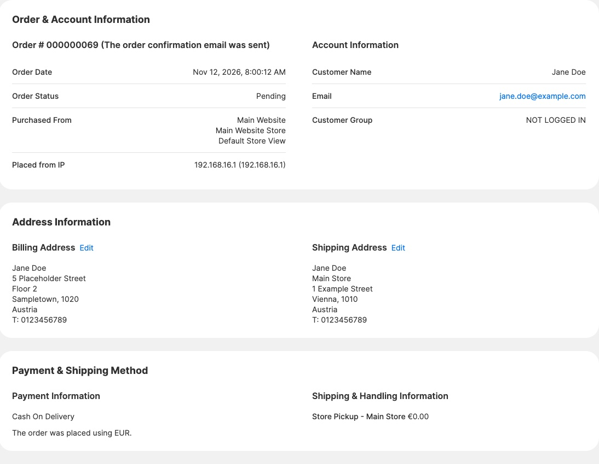

# Store Pickup for Hyvä Checkout

Hyvä Checkout companion for
[`pixelperfectat/magento2-module-store-pickup`](https://github.com/pixelperfectat/magento2-module-store-pickup).
It shows the chosen pickup location in place of the shipping address form and the location details under each pickup
rate. The module is not released yet.


- Selecting a pickup rate swaps the shipping address to the location, through the core module's address applier.
- The shipping address form is replaced by a read-only location card while a pickup rate is selected.
- The selected pickup rate shows the location details beneath it.
- The billing address stays the customer's own.
- The payment list and the totals refresh through the events the switch emits. No JavaScript is added.

## Requirements

- PHP `^8.3`
- `pixelperfectat/magento2-module-store-pickup` `^0.1`
- Hyvä Checkout `^1.3` (`hyva-themes/magento2-hyva-checkout`). It is a commercial package, so Composer only suggests
  it; install it from your Hyvä licence.

Tested with Hyvä Checkout 1.3.14 (Magewire 1.13).

## Installation

```bash
composer require pixelperfectat/magento2-module-store-pickup-hyva-checkout
bin/magento setup:upgrade
```

## Configuration

There is no configuration of its own. Pickup locations, texts and payment rules are configured in the core module; see
its [README](https://github.com/pixelperfectat/magento2-module-store-pickup#configuration).

## How it works

All changes hook into Hyvä Checkout through plugins and layout XML. The core module's logic is reused, and nothing
runs in the browser beyond Hyvä's own Magewire requests.

| What | Where |
|---|---|
| Sync on method switch | Plugin on `MethodList::updatedMethod`. For a pickup rate it applies the location through the core applier and emits `shipping_address_saved` and `pp_pickup_changed`. Switching back restores the customer's address. |
| Location card | After-plugin on `AddressTypeShipping::getComponentViewBlock` returns the card block instead of the address form. |
| Re-render | A `pp_pickup_changed` listener is added to the shipping and billing address components through `Component::getListeners()`. Magewire reads listeners only through that method, so an after-plugin is enough; no layout or class override is needed. |
| Billing | Around-plugin on `BillingDetails::updatedBillingAsShipping` skips Hyvä's copy of the shipping address for pickup quotes. |
| Details under the rate | Plugin on the ViewModel method `MethodList::getAdditionalViewBlock` returns the child block `checkout.shipping.method.pppickup` (alias `pppickup`) of `checkout.shipping.methods`. |


The placed order carries the pickup location, as described in the core README.



## Customising

Override the templates in your theme, under the same module path:

- `PixelPerfect_StorePickupHyvaCheckout::checkout/address-view/pickup-location.phtml` (location card, block
  `checkout.shipping-details.pp-pickup`)
- `PixelPerfect_StorePickupHyvaCheckout::checkout/shipping/method/pickup-details.phtml` (details under the rate,
  block `checkout.shipping.method.pppickup`)

Both blocks get the ViewModel `PixelPerfect\StorePickupHyvaCheckout\ViewModel\PickupLocationView`; the layout is in
`view/frontend/layout/hyva_checkout_components.xml`.

Translations are included for `en_US`, `de_DE` and `it_IT`.

## Known limits

- The details appear only under the selected pickup rate, because Hyvä Checkout renders additional views for the
  selected method only.
- The "billing same as shipping" checkbox stays visible for pickup quotes but has no effect.
- Values typed into the shipping form in the last moment before a pickup rate is selected may not be restored when
  switching back (Magewire debounce).
- Location texts are resolved for the quote's store view. A store view that shares the base URL with another one must
  be selected through the store switcher (store cookie), as usual in Magento.

## License

MIT, see [LICENSE](LICENSE).
