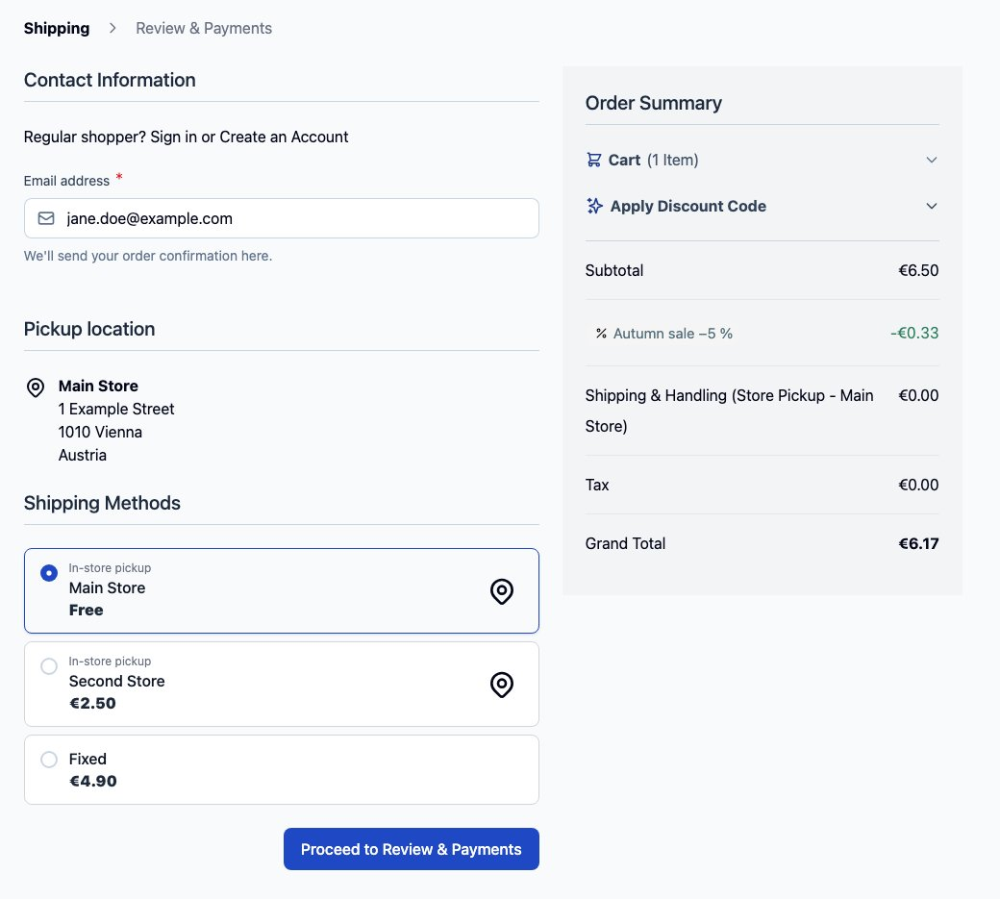
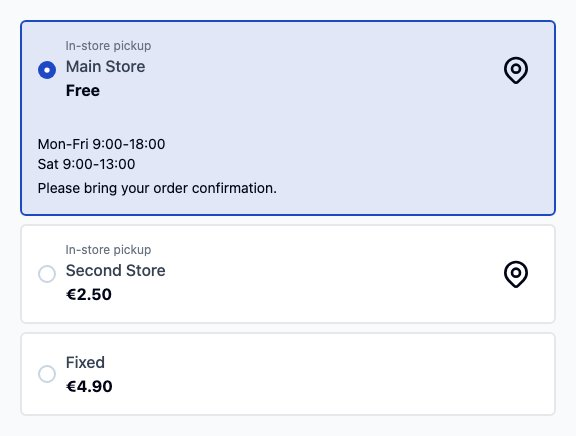
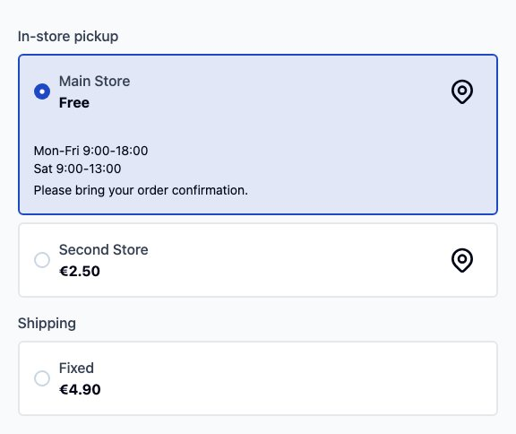
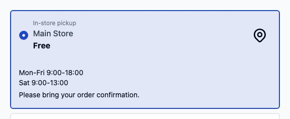
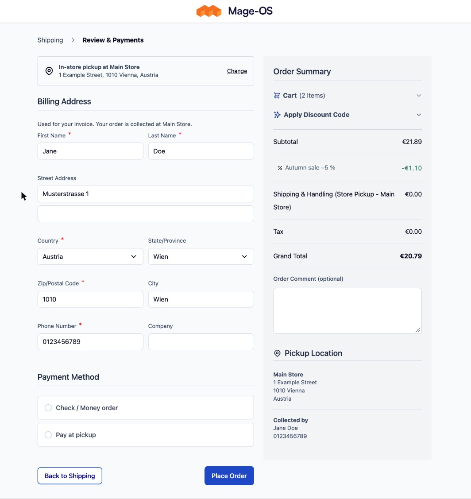

# Store Pickup for Hyvä Checkout

Hyvä Checkout companion for
[`pixelperfectat/magento2-module-store-pickup`](https://github.com/pixelperfectat/magento2-module-store-pickup).
It shows the chosen pickup location in place of the shipping address form, marks the pickup rates in the shipping method
list and shows the opening hours and note under the selected pickup rate. The module is not released yet.



- Selecting a pickup rate swaps the shipping address to the location, through the core module's address applier.
- The shipping address form is replaced by a read-only location card while a pickup rate is selected.
- While the card is shown, the section heading reads "Pickup location" instead of "Shipping Address", and the card
  shows the pin icon beside the location. Switching to another rate flips the heading back without a reload.
- Pickup rates are recognisable in the shipping method list: a small "In-store pickup" line above the location name,
  or separate "In-store pickup" and "Shipping" groups, chosen in the configuration.
- The selected pickup rate shows the location's opening hours and note beneath it (the address is already on the card
  above). A location with neither shows nothing there.
- A rate that costs nothing shows "Free" instead of the zero amount; a fee still shows the amount.
- The billing address stays the customer's own.
- On the payment step the "same address" checkbox is hidden for pickup and a hint says the billing address is used for
  the invoice. In the default (multi-step) checkout and checkouts that inherit from it, a banner also names the pickup
  location (with a "Change" link back to the shipping step) and the order summary shows a pickup card instead of
  "Ship To" and "Shipping Method".
- The payment list and the totals refresh through the events the switch emits. No JavaScript is added.

## Requirements

- PHP `^8.3`
- `pixelperfectat/magento2-module-store-pickup` `^0.1`
- Hyvä Checkout `^1.3` (`hyva-themes/magento2-hyva-checkout`). It is a commercial package, so Composer only suggests
  it; install it from your Hyvä licence.

Tested with Hyvä Checkout 1.3.14 (Magewire 1.13).

## Installation

```bash
composer require pixelperfectat/magento2-module-store-pickup-hyva-checkout
bin/magento setup:upgrade
```

## Configuration

**Stores > Configuration > Sales > Store Pickup > Hyvä Checkout**, all settings per store view:

| Setting | Path | Default |
|---|---|---|
| Pickup Rates in the Shipping Method List | `pp_store_pickup/hyva_checkout/rate_display` | `label` |
| Pickup Rate Label (label mode) | `pp_store_pickup/hyva_checkout/rate_label` | empty = "In-store pickup", translated |
| Pickup Group Title (groups mode) | `pp_store_pickup/hyva_checkout/group_pickup_title` | empty = "In-store pickup", translated |
| Shipping Group Title (groups mode) | `pp_store_pickup/hyva_checkout/group_shipping_title` | empty = "Shipping", translated |

The rate display modes:

- `label`: a small, lighter line above the location name of each pickup rate.
- `groups`: the pickup rates under one heading, then all other rates in Hyvä's order under a second one. A group
  without rates has no heading.
- `none`: Hyvä's own list, unchanged.





Pickup locations, texts and payment rules are configured in the core module; see its
[README](https://github.com/pixelperfectat/magento2-module-store-pickup#configuration).

## How it works

All changes hook into Hyvä Checkout through plugins and layout XML. The core module's logic is reused, and nothing
runs in the browser beyond Hyvä's own Magewire requests.

| What | Where |
|---|---|
| Sync on method switch | Plugin on `MethodList::updatedMethod`. For a pickup rate it applies the location through the core applier and emits `shipping_address_saved` and `pp_pickup_changed`. Switching back restores the customer's address. |
| Location card | After-plugin on `AddressTypeShipping::getComponentViewBlock` returns the card block instead of the address form. |
| Re-render | A `pp_pickup_changed` listener is added to the shipping and billing address components through `Component::getListeners()`. Magewire reads listeners only through that method, so an after-plugin is enough; no layout or class override is needed. |
| Billing | Around-plugin on `BillingDetails::updatedBillingAsShipping` skips Hyvä's copy of the shipping address for pickup quotes. |
| Billing toggle | After-plugin on `AddressViewBilling::isVirtual` returns `true` for pickup quotes. Hyvä uses that method only to show the "same address" checkbox, so only the checkbox disappears. |
| Invoice hint and banner | Blocks `checkout.billing-details.pp-pickup-hint` (in `checkout.billing-details.before`) and `checkout.pp-pickup-banner` (payment step of the default checkout, before the billing section). Both render nothing unless a pickup location is selected. "Change" reuses Hyvä's own navigation component; no JavaScript is added. |
| Order summary | In the default checkout, the template of block `checkout.shipping-summary` is swapped for `checkout/shipping-summary.phtml`. For non-pickup quotes it delegates to Hyvä's own template, so delivery renders unchanged. |
| Rate display | The template of the Magewire block `checkout.shipping.methods` is set to the module's `checkout/shipping/method-list.phtml`. While an available pickup rate is listed and the mode is not `none`, it renders the module's list through the ViewModel `PixelPerfect\StorePickupHyvaCheckout\ViewModel\MethodListView`; otherwise it renders Hyvä's `Hyva_Checkout::checkout/shipping/method-list.phtml` unchanged. |
| Details under the rate | Plugin on the ViewModel method `MethodList::getAdditionalViewBlock` returns the child block `checkout.shipping.method.pppickup` (alias `pppickup`) of `checkout.shipping.methods`. |





The placed order carries the pickup location, as described in the core README.


## Customising

Override the templates in your theme, under the same module path
(`PixelPerfect_StorePickupHyvaCheckout::`):

- `checkout/address-view/pickup-location.phtml`: location card, block `checkout.shipping-details.pp-pickup`
- `checkout/shipping/method/pickup-details.phtml`: opening hours and note under the rate, block
  `checkout.shipping.method.pppickup`
- `checkout/shipping/method-list.phtml`: the shipping method list, block `checkout.shipping.methods`
- `checkout/shipping/method-item.phtml`: one rate of the module's list, including the pickup label
- `checkout/shipping/method-group.phtml`: one group (heading and rates) in the groups mode
- `checkout/shipping-summary.phtml`: order summary, block `checkout.shipping-summary` (a theme that overrides that
  block's template replaces the pickup card too)
- `checkout/pickup-banner.phtml`: payment step banner, block `checkout.pp-pickup-banner`
- `checkout/address-view/billing-pickup-hint.phtml`: invoice hint, block `checkout.billing-details.pp-pickup-hint`

The item and group templates render in the context of block `checkout.shipping.methods`, so `$magewire` and Hyvä's
view models are available as in Hyvä's own list. Instead of overriding them in the theme, you can point the block
arguments `pp_method_item_template` and `pp_method_group_template` of `checkout.shipping.methods` to other templates.

The module's list replaces Hyvä's list template while a pickup rate is listed. If your theme or another module
customises `Hyva_Checkout::checkout/shipping/method-list.phtml`, those changes do not show in the module's list (they
still show when no pickup rate is listed). Set the rate display to `none` to keep Hyvä's template, and with it your
customisation, at all times. The module's list keeps Hyvä's contract: the radios with `wire:model="method"`, the
`hyvaCheckoutShippingMethodOption` Alpine component with `data-disabled`, the rate error message, the metadata icon,
the additional view of the selected rate and the incl./excl. tax display.

All blocks except the method list get the ViewModel `PixelPerfect\StorePickupHyvaCheckout\ViewModel\PickupLocationView`. The layout
is in `view/frontend/layout/`: the summary swap in `hyva_checkout_default.xml`, the banner in
`hyva_checkout_default_payment.xml`, the rest in `hyva_checkout_components.xml`.

If you offer a payment method for pickup only (see the core module's payment rules), consider naming it "Pay at
pickup" (store view specific method title, for example `payment/cashondelivery/title`).

The pickup rates, the payment step banner and the summary card share one icon, the ViewModel
`PixelPerfect\StorePickupHyvaCheckout\ViewModel\PickupIcon`. The default is Hyvä's `heroicons/outline/location-marker`
(a map pin). To use another icon, set the `iconPath` argument in your `di.xml`; the path has the format of Hyvä's
`SvgIcons` (icon set and name, without `.svg`):

```xml
<type name="PixelPerfect\StorePickupHyvaCheckout\ViewModel\PickupIcon">
    <arguments>
        <argument name="iconPath" xsi:type="string">heroicons/outline/home</argument>
    </arguments>
</type>
```

An icon set on a pickup rate through layout metadata (block `checkout.shipping.method.pppickup_<code>`, argument
`metadata`) wins over the default.

Heading: Hyvä's "Shipping Address" title sits outside the Magewire component that re-renders on a rate switch, so it
cannot be changed on the server. The card hides it visually with a small `<style>` rule
(`#shipping-details:has(.pp-pickup-card) > legend`, the usual screen-reader-only pattern, so the fieldset keeps its
accessible name) and renders its own title with the same markup and classes. The rule needs a browser with `:has()`
support; elsewhere both titles show. A strict Content Security Policy that blocks inline styles needs the rule in
your theme CSS instead.

"Free": the plugin `Plugin\ViewModel\Checkout\Formatter\ShowFreeShippingRates` adds a condition to Hyvä's price
formatter for the shipping method list. Hyvä's conditions do not see the shipping method, so it applies to every
zero-priced rate in the list, not only to pickup rates. To switch it off, set the `enabled` argument in your `di.xml`:

```xml
<type name="PixelPerfect\StorePickupHyvaCheckout\Plugin\ViewModel\Checkout\Formatter\ShowFreeShippingRates">
    <arguments>
        <argument name="enabled" xsi:type="boolean">false</argument>
    </arguments>
</type>
```

The module registers itself for Hyvä's Tailwind build (`hyva:config:generate`), so its templates are scanned.

Translations (including "Free") are included for `en_US`, `de_DE` and `it_IT`.

## Known limits

- The opening hours and note appear only under the selected pickup rate, because Hyvä Checkout renders additional views for the
  selected method only.
- The banner and the pickup summary card apply to the default (multi-step) Hyvä Checkout and checkouts that inherit
  from it. On the one-page checkout only the hidden checkbox and the invoice hint apply, because that layout loads
  neither `hyva_checkout_default.xml` nor `hyva_checkout_default_payment.xml`.
- The invoice hint sits outside the billing Magewire component and does not follow a live switch between pickup and
  delivery until the next step change or reload. The hidden checkbox does follow it.
- Values typed into the shipping form in the last moment before a pickup rate is selected may not be restored when
  switching back (Magewire debounce).
- Location texts are resolved for the quote's store view. A store view that shares the base URL with another one must
  be selected through the store switcher (store cookie), as usual in Magento.

## License

MIT, see [LICENSE](LICENSE).
